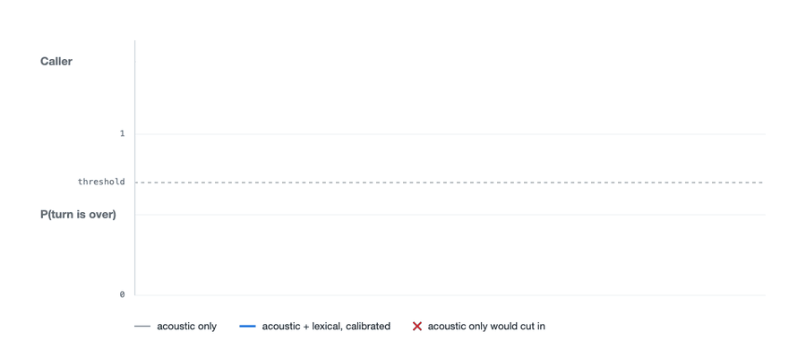

<h1 align="center">EOU Detector</h1>

<p align="center">
  <b>When has the caller finished speaking?</b><br>
  Real-time end-of-utterance detection for French voice agents: sound + meaning, calibrated.
</p>

<p align="center">
  <a href="#results"></a>
  <a href="https://github.com/livekit/eot-bench"></a>
  <a href="dissertation/diss.pdf"></a>
  
  
  <a href="LICENSE"></a>
</p>

<p align="center">
  <picture>
    <source media="(prefers-color-scheme: dark)" srcset="docs/hero-dark.gif">
    
  </picture>
  <br><sub>Illustrative curves. The AUC figures below are measured.</sub>
</p>

## The problem

A patient spells their name: "A… Z… A… N." Each letter is followed by a silence. A
detector that only listens for silence treats that pause as the end of the turn and
cuts the patient off. If you raise the silence timer to avoid this, every reply becomes
slower.

## The approach

1. **Fuse two signals.** Smart Turn v3 gives `p_ac` from the audio. A French CamemBERT
   classifier reading the partial transcript gives `p_lex`.
2. **Calibrate** the fused probability, so that 0.8 really means 80%.
3. **Pick the endpoint from a cost**, interruption vs. latency, instead of a fixed timer.

No large language model sits in the decision loop. The decision never waits for the ASR:
only the acoustic ONNX model runs on the critical path.

## Results

Public French benchmark ([LiveKit eot-bench](https://github.com/livekit/eot-bench)),
per-span AUC, bootstrap resampled by call:

| Model | AUC | Latency @ 5% |
|---|---|---|
| Smart Turn v3 (acoustic only) | 0.814 | 873 ms |
| Lexical only | 0.845 | n/a |
| **Fusion (this work)** | **0.897** | **715 ms** |
| LiveKit v1-mini (commercial) | 0.884 | 798 ms |
| Deepgram Flux (commercial) | 0.915 | 676 ms |

- **Gain:** +0.083 AUC over the acoustic baseline (95% CI [0.063, 0.104], p < 1/3000).
- **Calibration:** every external detector evaluated is miscalibrated (ECE 0.08 to 0.22),
  and none reports it. The fusion scores ECE 0.064 raw and 0.043 after calibration.
- **Production (negative result):** on 636 real medical calls at 8 kHz, the acoustic
  branch falls to chance (AUC 0.49) and fusion does not beat the lexical branch alone
  (0.59 vs. 0.60). The off-the-shelf pipeline does not transfer to narrowband telephony.

Full write-up: [`dissertation/diss.pdf`](dissertation/diss.pdf). To reproduce every
number, see [`docs/reproduce.md`](docs/reproduce.md).

## Quickstart

```bash
python -m venv .venv && source .venv/bin/activate
pip install -r requirements.txt
python scripts/fetch_models.py           # Smart Turn v3 ONNX -> ./models
```

**Offline smoke test** (no credentials, no models):

```bash
python demo.py --wav clip.wav --no-realtime --asr scripted --acoustic stub --lexical rules
```

**Live demo** (needs Azure Speech for partial transcripts):

```bash
cp .env.example .env                     # set AZURE_STT_API_KEY and AZURE_STT_REGION
python demo.py --mic                     # terminal
python webdemo.py                        # browser: http://127.0.0.1:8970
```

The web demo shows the partial transcript, the `p_ac` / `p_lex` / `p_eou` bars, and the
ENDPOINT/WAIT decision at each pause.

By default, the lexical branch loads a fine-tuned CamemBERT from `models/camembert-eou`.
These weights are not distributed: train them with `eou_detector/dataset/train_camembert.py`,
or pass `--lexical rules` to use the French rule engine instead.

**Tests:** `pytest`. Integration tests are skipped when models or credentials are missing.

## Architecture

```
mic / wav → Silero VAD ─┬─ ring buffer ──→ Smart Turn v3 ──→ p_ac ─┐
                        ├─ Azure ASR (partials) ──→ CamemBERT ──→ p_lex ─┤
                        └─ on each pause ──→ fusion → calibration → cost threshold → END / WAIT
```

| Path | What |
|---|---|
| `eou_detector/` | Streaming pipeline: `vad`, `asr`, `eou` (acoustic + lexical), `fusion`, `endpoint`, `orchestrator` |
| `eou_detector/eval/` | Benchmark adapters, calibration study, decision layer, production validation |
| `eou_detector/dataset/` | Lexical dataset builder, baselines, CamemBERT training |
| `eval/` | Clip-based harness: accuracy, false positives/negatives, latency |
| `dissertation/` | LaTeX source and PDF |

Every stage sits behind an interface. To swap the ASR, implement
`eou_detector/asr/base.py:ASR`. To swap the VAD, implement `eou_detector/vad/base.py:VAD`.
All thresholds live in `eou_detector/config.py`.

## What's next

- An acoustic model adapted to 8 kHz telephony.
- A small hand-labelled in-domain set, for a reliable production measurement.
- Sequential optimal stopping instead of a one-shot threshold.

## License

MIT. No patient data is in this repository: `data/`, audio and model weights are git-ignored.
